# Wine Tracker

Wine Tracker is an iOS app for cataloguing a personal wine collection. Wines are recorded along with their domain, creator, type, and vintage. The app also keeps track of bottle counts (unopened and consumed), used in the home page as totals and highlights.

Using Core Data backed with SQLite, collections are persisted on-device. Several collections can be kept separate on the same phone, each behind its own account, and accounts can be merged when two collections should become one.

The app UI is made with SwiftUI.

<p align="center">
  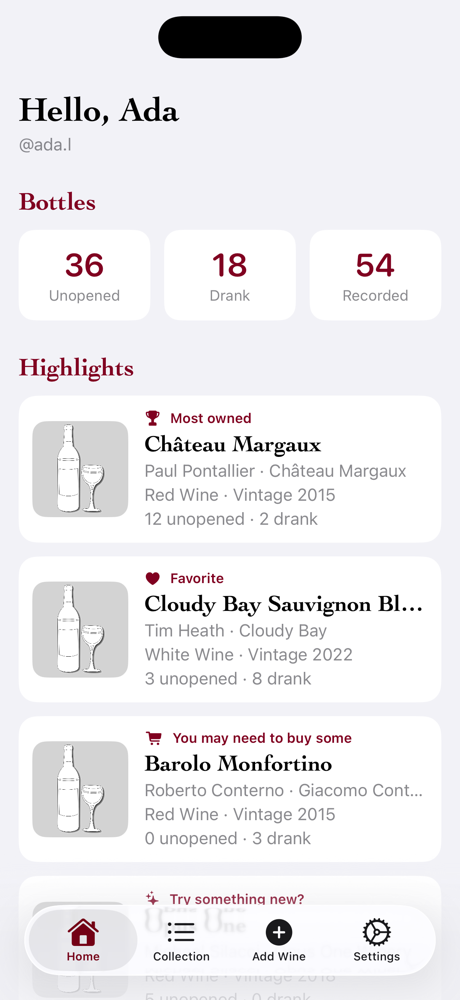
  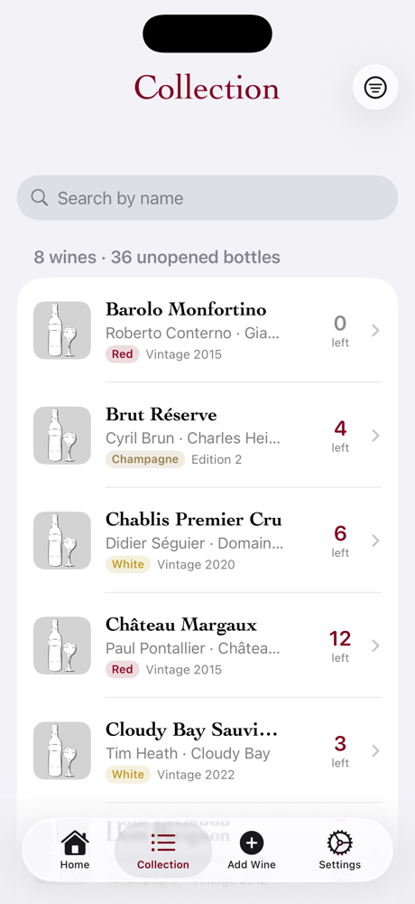
  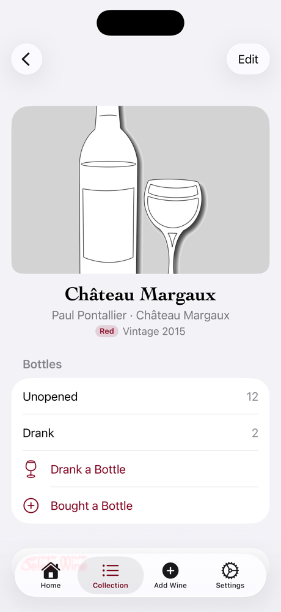
</p>

## Building and running

Require Xcode 26+ and iOS 26.1+ or newer, on a device or simulator.

1. Clone the repository and open the project:

   ```bash
   git clone https://github.com/victorm15/WineTracker.git
   cd WineTracker
   open wine_tracker.xcodeproj
   ```

2. Choose the `wine_tracker` scheme and an iOS simulator, for example iPhone 17 Pro.
3. Press **Run**.

The app starts with an empty database. Create an account on the **Sign Up** page, then log in.

## Features

### Login and Signup Pages

<p align="center">
  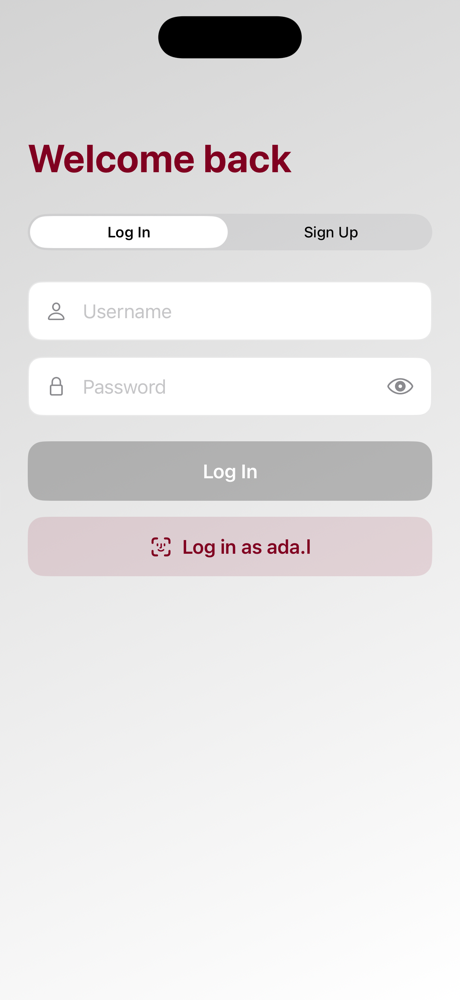
  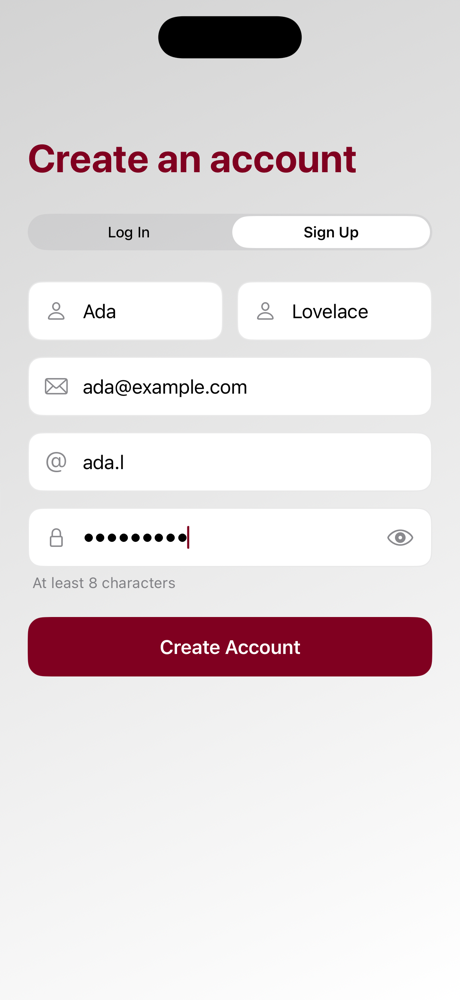
  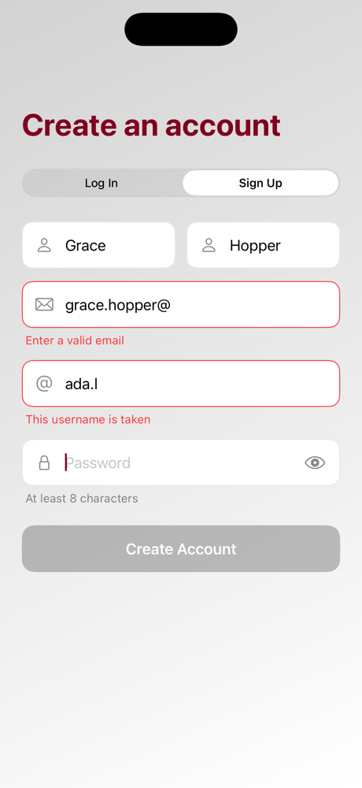
  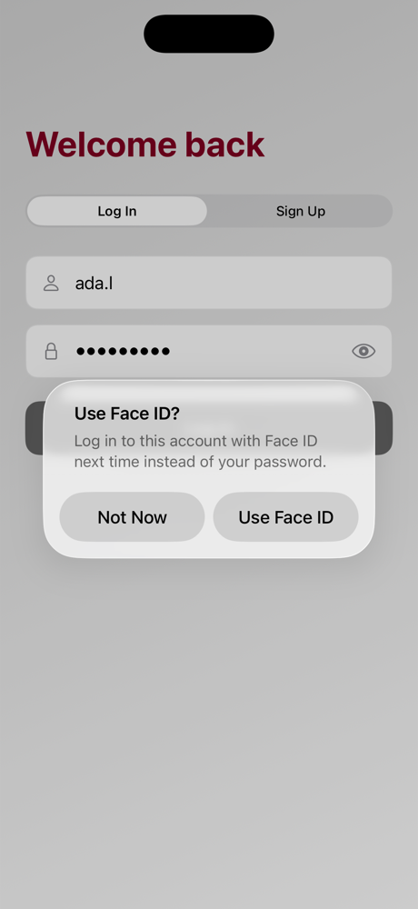
</p>

- **Sign-up checks each field as you leave it.** Names need at least two characters, the email must be valid (regex), the username must be unique among the on-device accounts, and the password needs at least eight characters.
- **Passwords are never stored.** Passwords are salted and hashed with PBKDF2-SHA256 (600,000 rounds) and kept in the iOS Keychain. A wrong username takes as long to reject as a wrong password, so failed logins don't reveal which usernames exist.
- **Biometric login** is offered after a password login, and can be turned on or off in Settings. The account it unlocks is stored in a Keychain item that only biometrics can open.

### Home

<p align="center">
  
</p>

- **Bottle totals:** unopened, drank, and total recorded.
- **Highlights**, each with the wine's photo and details:
  - Most owned wine
  - Favourite wine
  - A wine you may need to restock
  - A wine you have yet to try

### Collection

<p align="center">
  
  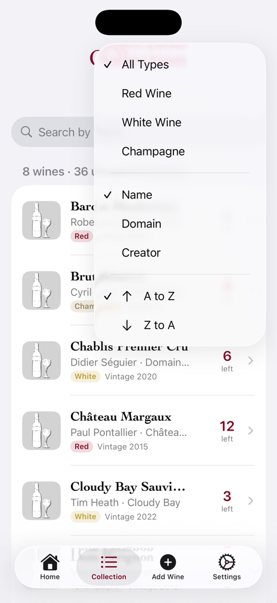
  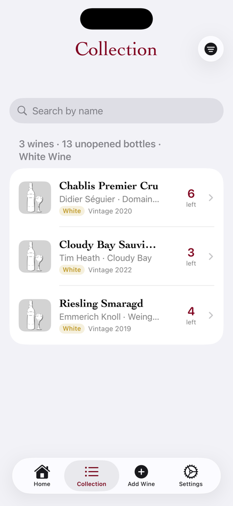
</p>

- **See the collection as a list**, with its photo, type, vintage, and how many bottles are left. The header shows how many wines and unopened bottles the current list contains.
- **Filter by type** (red, white or champagne) and **sort** by name, domain or creator, A to Z or Z to A.

<p align="center">
  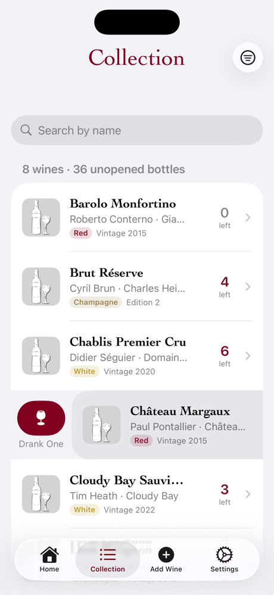
</p>

- **Swipe right** on a wine to log a bottle you drank. **Swipe left** to delete it.

<p align="center">
  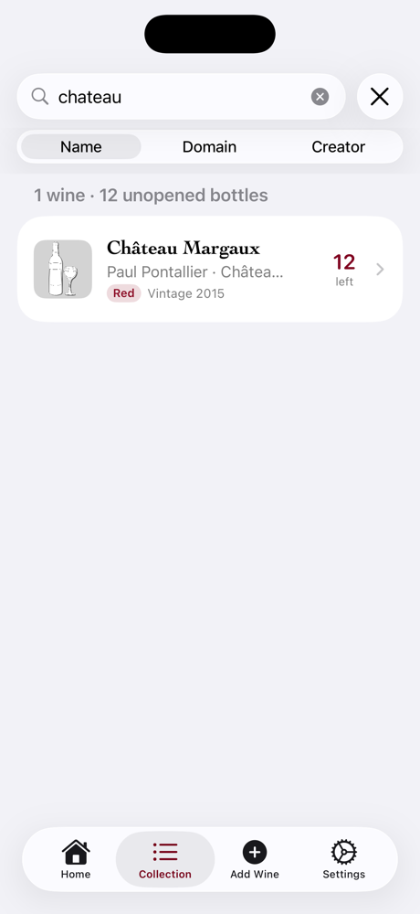
</p>

- **Search by name, domain or creator.** Matches can be anywhere in the text, and case and accents don't matter: e.g. "chateau" finds "Château Margaux".

<p align="center">
  
  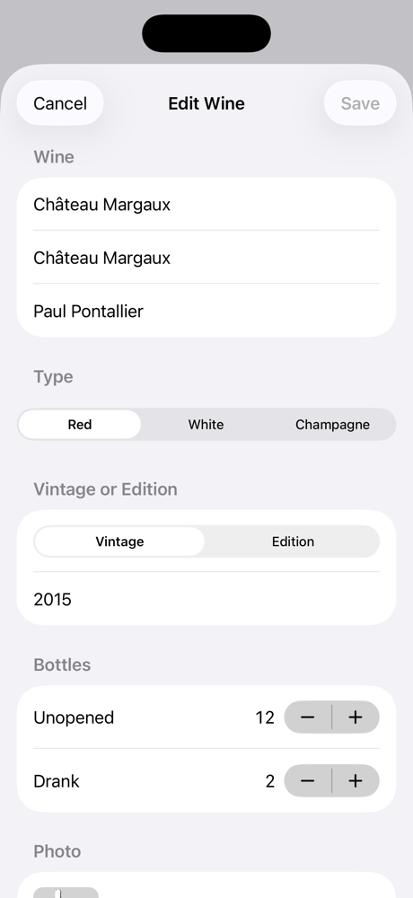
</p>

- Clicking on a wine entry leads you to a detailed page, with the wine's photo and details, and buttons for **Drank a Bottle** and **Bought a Bottle** which change bottle counts.
- Press **Edit** to modify fields, including the photo. **Save** stays off until something has changed.
- **Duplicates are caught.** If an edit makes a wine identical to another one in the collection, the app offers to combine the two and add their bottle counts together.

### Adding Wines

<p align="center">
  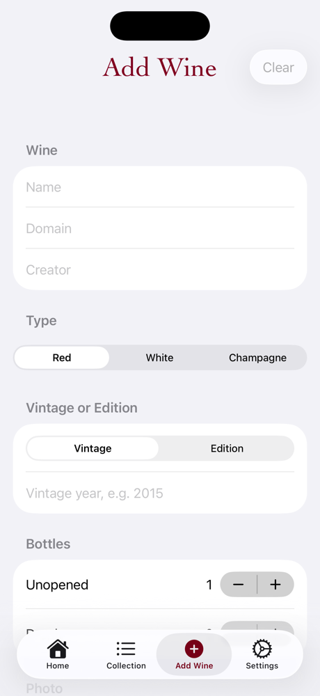
  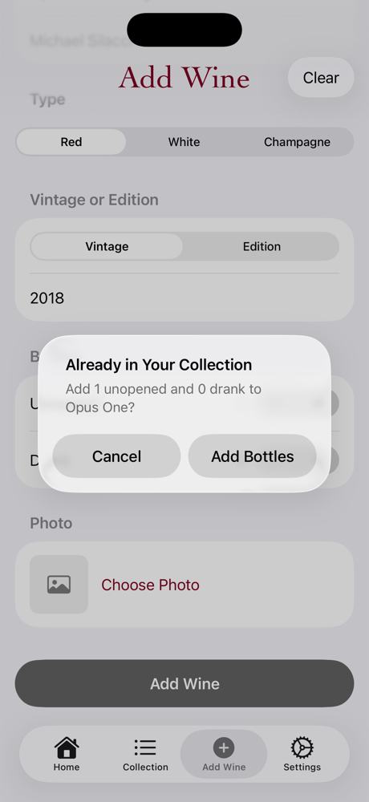
</p>

- **A native form** for name, domain, creator, type, vintage year or edition number, bottle counts and an optional photo. Photos are shrunk before saving to keep the database small.
- Missing or invalid fields are named under their section, and the form jumps to the first one.
- **Duplicates are caught:** adding a wine that's already in the collection offers to add the bottles to the existing entry instead.

### Settings

<p align="center">
  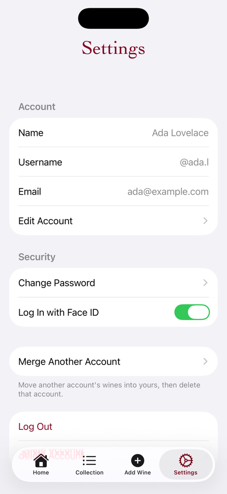
  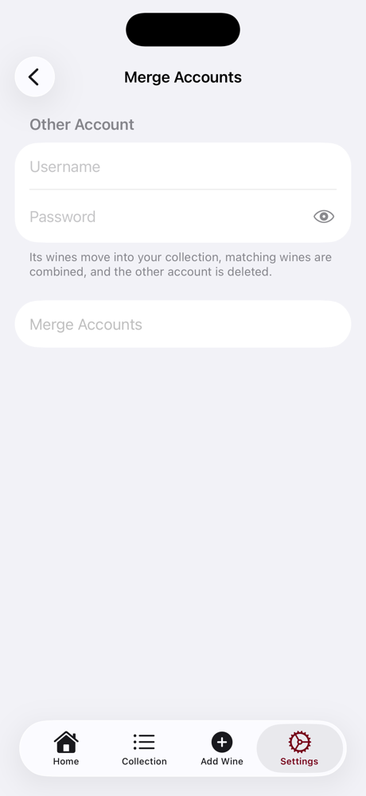
</p>

- **Edit your account:** name, username and email, with the same rules as sign-up.
- **Change your password.** Your current password is required. If saving fails, the old password keeps working.
- **Turn Face ID login on or off.**
- **Merge another account.** Log in to a second account to move its wines into yours. Matching wines are combined, and the other account is deleted.
- **Log out**, or **delete your account** and its collection (password required).

## Caching Collection Queries

An account's wines are loaded from the database once upon logging-in. The result of collection queries (a search, filter, and sort combination) are cached in an in-memory LFU-with-aging cache:

- The cache holds up to five query results for the logged-in account
- Each use of a query raises its score, and older query scores decay. When a sixth query is added, the lowest-scoring one is evicted.
- After a change to the collection, the cached lists are updated in place: wines that have been deleted or edited such that they no longer match the query are taken out, while new or edited wines that now match the query are inserted at their sorted position with a binary search. Cached lists are never filtered or sorted from scratch.
- The cache is discarded when you log out or switch accounts.